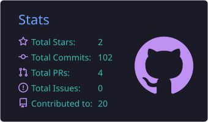
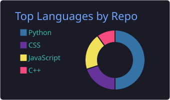

<div align="center">

<!-- HEADER BANNER. Optional: put an animated One Piece / AoT / Re:Zero GIF under it as assets/header.gif -->


<br/>

<a href="https://github.com/DevWithOm">
  
</a>

<br/><br/>

<a href="https://drive.google.com/file/d/1brpMbX1RFPulYGVYMBrwezfXINYwC6V1/view?usp=sharing"></a>
<a href="https://www.linkedin.com/in/om-vyas-546b9a3a5"></a>
<a href="https://devwithom.github.io/portfolio"></a>
<a href="mailto:omrv0196@gmail.com"></a>

<br/>

<a href="https://leetcode.com/u/om_vyas_21"></a>
<a href="https://www.codechef.com/users/om_vyas_21"></a>
<a href="https://www.instagram.com/om_vyas_21"></a>
<a href="https://discord.com/users/824951094063923201"></a>
<a href="https://www.reddit.com/user/OmKing2263"></a>
<a href="https://pin.it/1xTGDIG8a"></a>
<a href="https://open.spotify.com/user/7l30rw83vcbb190lq1qi96fwb"></a>

<br/><br/>


</div>

<br/>

## 🏴‍☠️ Crew Manifest

> *Part Subaru (die, learn, retry), part Andrew Neiman (never satisfied with "good enough"), with Luffy's stubborn belief that the next island is always reachable. I debug like Sherlock, and Dark taught me that everything is connected, including the bug I ignored three commits ago.*

```json
{
  "name": "Om Ram Vyas",
  "alias": "DevWithOm",
  "role": "B.Tech CSE (AI & ML) @ MIT Academy of Engineering, Pune",
  "team": "Algorithm Busters",
  "sih_2026": "Team Lead, VAJRA-X21",
  "focus": [
    "Agentic AI & multi-agent systems",
    "Geospatial / ocean / climate intelligence",
    "Responsible AI (bias detection, guardrails)",
    "Full-stack AI products that actually ship"
  ],
  "currently": "Clearing rounds at Indradhanu Grand Challenge 2026",
  "motto": "Fail the round. Fix the idea. Ship it again."
}
```

<br/>

## 🏆 Bounty Board

| 🎖️ Bounty | Where |
|:--|:--|
| 🥉 **2nd Runner-Up** | NIRMAAN 4.0 2026, GDG on Campus MITAOE, Pune |
| 🌍 **Top 106 of 6,700+ teams** | Google Solution Challenge 2026 (GDG × Hack2Skill) |
| 🛰️ **Won the internal round** | Smart India Hackathon 2026. Team **VAJRA-X21** (Team Lead) submitted **SIH26189** and **SIH26066** on the official portal |
| 🔥 **PPT round cleared, ongoing** | Indradhanu International Grand Challenge 2026, PCCOE Pune |

<details>
<summary><b>📜 Full Return-by-Death log (every hackathon, every round)</b></summary>

<br/>

| Event | Organiser | How far I got |
|:--|:--|:--|
| Datathon 2026 | GirlScript Club, MITAOE | Cleared PPT round, out at online interview |
| Airavat 3.0 | SPIT, Mumbai | Out at PPT round |
| Offgrid 1.0 2026 | DYPIU, Pune | Cleared PPT round, out at video screening |
| Bharatiya Antariksh Hackathon 2026 | ISRO × Hack2Skill | Out at PPT round |
| Adobe University Hackathon 2026 | Adobe | Out in round 1 |
| Tata Imagination Challenge 2026 | Tata Group | Reached round 3 |
| VIT Code Apex 3.0 | Vishwakarma Institute of Technology, Pune | Out after PPT round |
| Kurukshetra 2026 (24-hour) | Dr. D.Y. Patil Institute of Technology, Pimpri, Pune | Participated |
| Sustainability Hackathon 2026 | IIT Bombay × Honeywell | Idea not selected |
| Hacktoberfest 2026 | Mauji Cafe, Pune and Technogise, Pune | Participated in both |

*Every "out" above is a checkpoint, and the next run starts with the notes from the last one.*

</details>

<br/>
<hr/>
<br/>

## 🧭 Expeditions (Featured Projects)

<table width="100%">
  <tr>
    <td width="50%" valign="top">
      <h3>👁️ <a href="https://netra-ebon.vercel.app">NETRA</a></h3>
      <i>AI-powered criminal intelligence command center, built for SIH 2026 (<b>SIH26189</b>) with Mumbai City Police as the pilot jurisdiction.</i><br/><br/>
      <a href="https://netra-ebon.vercel.app"></a>
      
    </td>
    <td width="50%" valign="top">
      <h3>🌊 <a href="https://ocean-embed-ten.vercel.app">OceanEmbed-X</a></h3>
      <i>Satellite-to-subsurface ocean intelligence platform for the North Indian Ocean, built for SIH 2026 (<b>SIH26066</b>).</i><br/><br/>
      <a href="https://ocean-embed-ten.vercel.app"></a>
      
    </td>
  </tr>
  <tr>
    <td width="50%" valign="top">
      <h3>🐙 <a href="https://nautilus-ai.vercel.app">NautilusAI</a></h3>
      <i>Multi-agent ocean intelligence system built for GDGoC NIRMAAN 4.0 (2nd Runner-Up). Agents reason over NASA Earthdata, Copernicus Marine, ERA5 and INCOIS data.</i><br/><br/>
      <a href="https://nautilus-ai.vercel.app"></a>
      
      
      
      
    </td>
    <td width="50%" valign="top">
      <h3>⚖️ <a href="https://fairlens-f1922.web.app">FairLens</a></h3>
      <i>AI bias detection and remediation platform with per-group TPR/FPR metrics, an intersectional bias matrix, and Gemini-powered remediation and compliance reports (EEOC, DPDP, EU AI Act). <b>Google Solution Challenge 2026, Top 106.</b></i><br/><br/>
      <a href="https://fairlens-f1922.web.app"></a>
      
      
    </td>
  </tr>
  <tr>
    <td width="50%" valign="top">
      <h3>🤖 <a href="https://agentica-two.vercel.app">Agentica</a></h3>
      <i>Pay-per-call agent economy: discover AI microservices, orchestrate multi-step tasks, and inspect cryptographic settlements, powered by x402 micropayments on Base Sepolia.</i><br/><br/>
      <a href="https://agentica-two.vercel.app"></a>
      
      
    </td>
    <td width="50%" valign="top">
      <h3>🌍 <a href="https://travelsphere-phi.vercel.app">TravelSphere</a></h3>
      <i>AI-powered smart travel planner styled like a 19th-century explorer's journal: itineraries, destination oracle, budget tracking and multi-currency expenses.</i><br/><br/>
      <a href="https://travelsphere-phi.vercel.app"></a>
      <a href="https://github.com/DevWithOm/Travelsphere"></a>
      
      
      
    </td>
  </tr>
  <tr>
    <td colspan="2" valign="top">
      <h3>🛡️ <a href="https://github.com/DevWithOm/AgentGuard">AgentGuard</a> <sub>(bonus quest)</sub></h3>
      <i>Security proxy for autonomous AI agents: an input guard scores prompt injection, an output guard blocks exfiltration, and a Temporal workflow keeps the pipeline crash-resilient.</i><br/><br/>
      <a href="https://github.com/DevWithOm/AgentGuard"></a>
      
      
      
      
    </td>
  </tr>
</table>

<br/>
<hr/>
<br/>

## ⚔️ Arsenal (Tech Stack)

<div align="center">
  
</div>

<br/>

| Domain | Tools |
|:--|:--|
| **Languages** |      |
| **Frontend** |    |
| **Backend** |    |
| **Agentic AI & LLMs** |      |
| **ML & Data** |     |
| **Databases & Geo** |      |
| **Deploy & Tools** |     |
| **AI-native workflow** |     |

<br/>
<hr/>
<br/>

## 🏅 Certifications & Badges

*Click any badge to verify it.*

**🧠 Claude Academy**
<br/>
<a href="https://academy.claude.com/verify/da8fa191c27ff0b5c252cff3cb2cd123"></a>
<a href="https://academy.claude.com/verify/0f47e84cdab80d0f6af13f8d75ed54e3"></a>
<a href="https://academy.claude.com/verify/a927de93a275f554ce76fb90194bc563"></a>
<a href="https://academy.claude.com/verify/ac4ba7b3682fb86cf9541869729b1522"></a>
<a href="https://academy.claude.com/verify/171ab582ae33752e6a5de7c4803fcf6d"></a>
<a href="https://academy.claude.com/verify/93fd4af4ed707a545da30bf5d977df76"></a>
<a href="https://academy.claude.com/verify/937541b5d788dae27db438ae179d343f"></a>
<a href="https://academy.claude.com/verify/7e69d31f01e70983e57ad0d56fa99fec"></a>
<a href="https://academy.claude.com/verify/a4d17ba244a5c8cb0aae12153f72b745"></a>
<a href="https://academy.claude.com/verify/36cf616a163d55c900e57f68dac04ad0"></a>
<a href="https://academy.claude.com/verify/df76c339b685f319647b72828bb4c283"></a>

<br/>

**🔷 IBM SkillsBuild**
<br/>
<a href="https://www.credly.com/badges/b65a142c-da19-4e20-aefe-6e7811048a49/public_url"></a>
<a href="https://www.credly.com/badges/8db048ee-3425-4d01-bfc9-4838ba0b9dde/public_url"></a>

**🌐 Cisco Networking Academy**
<br/>
<a href="https://www.credly.com/badges/de3db411-ad6f-4617-bff3-576d6a4a6c4f/public_url"></a>
<a href="https://www.credly.com/badges/c4f260d6-79cf-4960-bdfa-03917435af1e/public_url"></a>
<a href="https://www.credly.com/badges/05b71da3-8e95-4eb6-be7b-55db4214afbd/public_url"></a>
<a href="https://www.credly.com/badges/99814e29-e6a9-4458-b69a-c303c78d2ef7/public_url"></a>
<a href="https://www.credly.com/badges/73a167c8-2c7f-490a-8c1a-c60da1203246/public_url"></a>

**☁️ AWS · Kaggle · CII & HP · Outskill**
<br/>
<a href="https://www.credly.com/badges/88d0cfef-20b3-480a-bbd0-3f312ab9dafc/public_url"></a>
<a href="https://www.kaggle.com/learn/certification/omvyas1234/intro-to-programming"></a>


<sub>CII & HP certificate no. 23CII-FJ26-49699</sub>

<br/>
<hr/>
<br/>

## 🎒 Crew & Roles

- 🌐 **Cisco Virtual Internship Program**: 2-month virtual internship
- 🤖 **ASTRA** (AIML student association, MITAOE): member of the technical team
- 🎓 **AMIEE Student Chapter**: lifetime member
- 🏴‍☠️ **Algorithm Busters**: hackathon crew; **VAJRA-X21**: SIH 2026 team (Team Lead)

<br/>
<hr/>
<br/>

## 📺 My Watchlist (a.k.a. Where My Ideas Come From)

| 🏴‍☠️ Anime | 🎬 Movies | 📺 Series | 😂 Sitcoms |
|:--|:--|:--|:--|
| **One Piece** | **The Truman Show** | **Dark** | **How I Met Your Mother** |
| **Re:Zero** | **Whiplash** | **Sherlock (BBC)** | **Young Sheldon** |
| **Attack on Titan** | **Harry Potter** (the whole collection) | **Breaking Bad / Game of Thrones** *(undecided, send help)* | |

<br/>
<hr/>
<br/>

## 📊 Log Pose (GitHub Stats)

<div align="center">




<br/>


</div>

<br/>

## 🐍 Commit Snake

<div align="center">
  <picture>
    <source media="(prefers-color-scheme: dark)" srcset="https://raw.githubusercontent.com/DevWithOm/DevWithOm/output/github-snake-dark.svg"/>
    <source media="(prefers-color-scheme: light)" srcset="https://raw.githubusercontent.com/DevWithOm/DevWithOm/output/github-snake.svg"/>
    
  </picture>
</div>

<br/>
<hr/>
<br/>

## 🤝 Let's Set Sail Together

<div align="center">

**Open to:** hackathon teams · agentic AI and applied ML projects · open source · talking anime and *Dark* theories at 2 a.m.

<a href="mailto:omrv0196@gmail.com"></a>
<a href="https://www.linkedin.com/in/om-vyas-546b9a3a5"></a>

<br/><br/>

<i>"The next island is always reachable. You just have to keep sailing."</i>

<br/>


</div>
